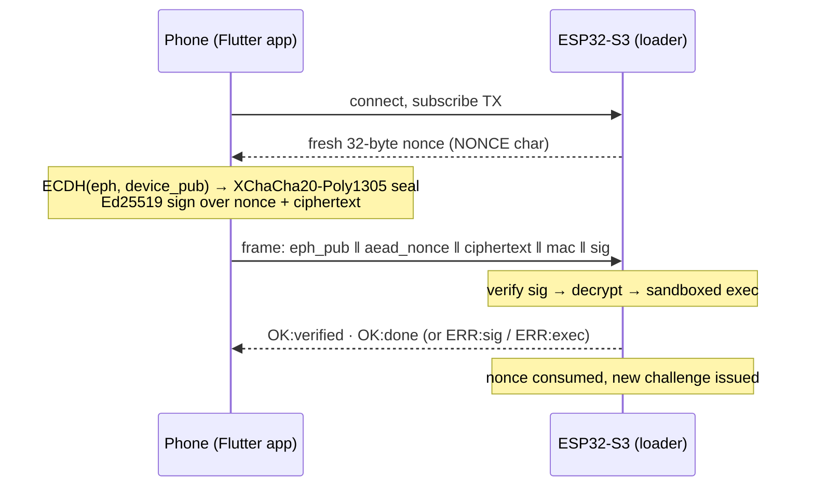

# CicadaOS

**Authenticated, confidential, ephemeral code push over BLE.**

A phone encrypts a small MicroPython script to an ESP32-S3's X25519 key and signs
the encrypted blob with an Ed25519 key. The device runs the script **only if** the
signature verifies against a nonce it just issued **and** the ciphertext decrypts
under its own private key. Scripts are never persisted on the device, every
connection is a fresh challenge, and a passive sniffer sees only ciphertext.

The device narrates its state on screen as a cicada life cycle — **egg** (waking) →
**nymph** (listening) → **molting** (receiving) → **emergence** (verifying) →
**adult** (running your script), or **rejected** when a signature doesn't belong to
its brood.

## How a push works



The exact wire bytes, the security model, and the byte-agreement contract between
the four implementations (firmware Python, vendored Monocypher C, Dart, vector
generator) are specified in [`CLAUDE.md`](CLAUDE.md) — the authoritative spec.

## What's in the repo

| Path | What it is |
|---|---|
| [`firmware/`](firmware/README.md) | MicroPython BLE peripheral for the ESP32-S3: framing, nonce lifecycle, Ed25519 verify, X25519 + XChaCha20-Poly1305 decrypt, sandboxed `exec`, and the cicada lifecycle display. Native crypto via a vendored [Monocypher](https://monocypher.org/) module (`ced25519/`), with pure-Python fallbacks. |
| [`app/`](app/README.md) | Flutter companion (BLE central): script library with encrypted-at-rest secret bodies, per-device key pinning, byte-exact frame builder, push state machine. Android-first; iOS via cloud CI. |
| [`firmware/tools/`](firmware/tools/README.md) | Desktop push client (`push_script.py`, bleak) — the byte-for-byte reference implementation — plus keygen and the cross-implementation vector generator. |
| [`firmware/examples/`](firmware/examples/README.md) | Pushable LVGL demo scripts (dashboard, charts, RGB ticker, …) for the target board. |

**Target hardware:** Waveshare **ESP32-S3-Touch-LCD-1.47** (JD9853 panel + AXS5106L
touch), loader built on [`lvgl_micropython`](https://github.com/lvgl-micropython/lvgl_micropython)
— see [`firmware/BUILD_LVGL.md`](firmware/BUILD_LVGL.md).

## Security model, in one paragraph

Protects against unsigned pushes, replay (single-use nonce), cross-unit replay
(per-device keys), passive sniffing (script encrypted to the device key), and
rogue/spoofed peripherals (only the real device can decrypt). On a hardened board
(Secure Boot v2 + flash encryption) it also resists flash extraction. It does
**not** protect against a compromised phone holding the signing key. Pushed
scripts run authenticated but sandboxed: no filesystem, no flash modules, so even
a signed script cannot rewrite the loader and persist.

> ⚠ **The keys shipped in `firmware/main.py` are throwaway test values.** Before
> any real deployment rotate both keys and, for secret-bearing units, burn the
> ESP32-S3 eFuses (Secure Boot v2 + Flash Encryption release mode). The full
> ceremony is in [`CLAUDE.md`](CLAUDE.md) ("Provisioning requirements") and the
> [firmware security notice](firmware/README.md#-security-notice--read-before-deploying).

## Quickstart

**1. Build & flash the loader** — [`firmware/BUILD_LVGL.md`](firmware/BUILD_LVGL.md)
(one image: LVGL + BLE + native crypto).

**2. Provision keys** (the boot guards refuse all-zero placeholders):

```bash
cd firmware/tools
python3 -m venv .venv && .venv/bin/pip install bleak cryptography
.venv/bin/python push_script.py --keygen          # signing keypair → PUBKEY for main.py
.venv/bin/python push_script.py --keygen-x25519   # per-unit device keypair → DEVICE_X25519_PRIV
```

Set `PUBKEY` and `DEVICE_X25519_PRIV` in `firmware/main.py`, reflash.

**3. Push a script** from the desktop client:

```bash
.venv/bin/python push_script.py ../examples/01_hello.py --device-priv <hex>
```

or build the app (`cd app && ../fdart.sh "flutter build apk --debug"`), pin the
device's X25519 public key in the device screen, and push from the library.

## Testing (no hardware needed)

```bash
python3 firmware/tests/test_flow.py    # full push flow, stdlib-only CPython
cd app && ../fdart.sh flutter test     # Dart unit tests (Docker, no host toolchain)
```

Cross-implementation correctness is proven by shared byte vectors:
`firmware/tools/make_vectors.py` emits `app/tools_vectors/vectors.json`; the Dart
tests assert byte-identical frames and the firmware tests decrypt the same vectors.

## Roadmap

See [`BACKLOG.md`](BACKLOG.md) — live dashboards fed by script `OUT:` JSON,
script actions, in-app AI script authoring.

## Licensing

**This repository is published without a license — all rights reserved.** It is
shared to show the work; it does not grant use, modification, or redistribution
rights. If you want to use any of it, open an issue and ask.

Third-party terms that apply regardless:

- **Monocypher** (`firmware/ced25519/`) — vendored verbatim from a pinned upstream
  release, `BSD-2-Clause OR CC0-1.0`. Its headers are intact; do not strip them.
- **flutter_blue_plus** (app BLE stack) — **not open source.** The
  *FlutterBluePlus License v1.5* is free only for personal, nonprofit, and
  accredited-educational use; **any for-profit use, including commercial use by an
  individual, requires a paid commercial license** (tiered by employee count). The
  app accordingly declares `License.nonprofit` in `lib/core/ble/fbp_transport.dart`.
  That declaration is a statement of fact about this project's use — anyone
  adapting this code for commercial purposes must obtain their own license and
  change it. The package also performs a **build-time license ping** (telemetry
  including package/app info at build time); this is a build-host behaviour and
  does not affect the runtime data-flow claims above.
